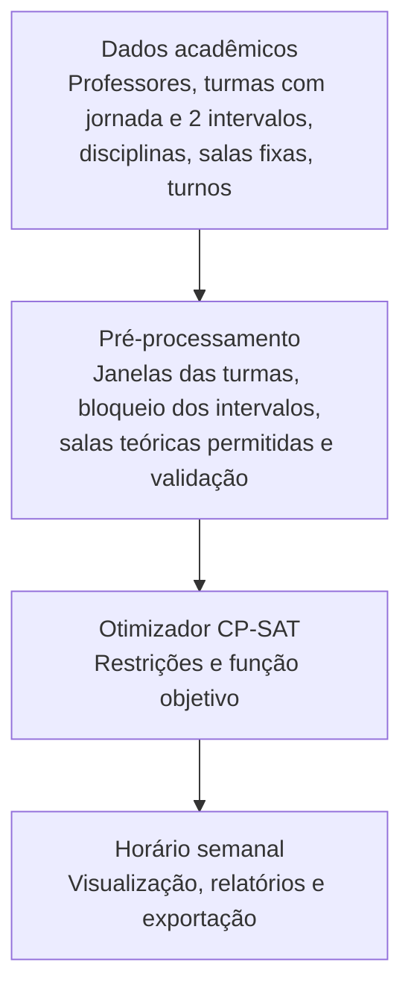

# Resumo

O sistema deve gerar um grade de horário para professores, considerando não apenas a distribuição das aulas, mas também a disponibilidade dos professores, a ocupação de salas, os turnos, a duração das aulas e a qualidade dos horários gerados.

Para implementação usar: C++ (seguindo padrão C++20), **Google OR-Tools com o solver CP-SAT**, interface gráfica com QT e dependencias devem ser gerenciadas com conan. Deve-se utilizar a programação orientada a objeto para representar as informações no código.


---

## 1. Definição do problema

Considere uma instituição que precisa organizar as aulas de segunda a sexta-feira, respeitando as seguintes características:

| Elemento | Características |
|---|---|
| Professores | Disponibilidade, carga horária, preferências de horários e **peso de preferência para cada dia da semana** |
| Dias | Segunda a sexta-feira |
| Aulas | Duração de 45 ou 50 minutos |
| Turnos | Manhã, tarde e noite |
| Salas | Sala teórica fixa por turma; salas alternativas ou múltiplas para atividades especiais |
| Turmas | Jornada por dia (início, fim e dois intervalos), sem sobreposição de aulas |
| Disciplinas | Quantidade de aulas semanais e professor responsável |
| Restrições adicionais | Intervalos, limites diários, horários bloqueados |

O problema consiste em determinar **quando, onde e com quais recursos cada aula será realizada**, minimizando conflitos e melhorando a distribuição dos horários.

### 1.1. Representação do tempo

Como existem aulas de 45 e 50 minutos, não é conveniente utilizar uma grade fixa de aulas de uma hora.

Uma solução é discretizar o tempo em intervalos de 5 minutos, pois:

$$
\operatorname{MDC}(45,50)=5
$$

Assim, uma aula de 45 minutos ocupa 9 intervalos, enquanto uma de 50 minutos ocupa 10.

**Exemplo: professor A — segunda-feira, manhã**

| Início | Término | Disciplina | Duração |
|---|---|---|---|
| 08:00 | 07:45 | Matemática | 45 min |
| 07:45 | 08:35 | Física | 50 min |
| 08:35 | 09:20 | Química | 45 min |

As três aulas são consecutivas, sem sobreposição, mesmo com durações diferentes.

A granularidade de 5 minutos não significa que o sistema precise permitir aulas começando a qualquer momento. É possível restringir os horários de início a uma lista de horários autorizados pela instituição.

---

## 2. Formulação matemática

### 2.1. Conjuntos e índices

Definimos os seguintes conjuntos:

| Símbolo | Descrição |
|---|---|
| $P$ | Conjunto de professores |
| $D$ | Dias da semana, de segunda a sexta |
| $A$ | Conjunto de ocorrências de aulas a alocar |
| $R$ | Conjunto de salas disponíveis |
| $G$ | Conjunto de turmas |
| $S$ | Conjunto de turnos: manhã, tarde e noite |
| $K_d$ | Intervalos de 5 minutos do dia $d$ |
| $B_a$ | Combinações de salas permitidas para a aula $a$ |

É importante distinguir uma disciplina de uma ocorrência de aula.

Se Matemática exige quatro aulas semanais, podemos representar essas aulas como:

$$
A_{\text{Matemática}}=\{a_1,a_2,a_3,a_4\}
$$

Cada ocorrência precisa receber um horário e uma sala.

### 2.2. Parâmetros

Para cada aula $a$, definimos:

$$
L_a=
\begin{cases}
9 & \text{aula de 45 minutos}\\
10 & \text{aula de 50 minutos}
\end{cases}
$$

Também são necessários:

- $P_a$: professores envolvidos na aula $a$.
- $G_a$: turmas participantes da aula $a$.
- $S_a$: turnos permitidos para a aula.
- $B_a$: conjuntos de salas admissíveis.
- $M_{p,d}$: carga máxima, em minutos, do professor $p$ no dia $d$.
- $\omega_{p,d}$: peso atribuído pelo professor $p$ ao dia $d$; na escala escolhida, $0$ indica o dia menos preferido e $10$ o mais preferido.
- $D_g$: dias de funcionamento da turma $g$ (subconjunto de segunda a sexta).
- $T^{ini}_{g,d}$ e $T^{fim}_{g,d}$: início e fim da jornada da turma $g$ no dia $d$.
- $J^{(1)}_{g,d}$ e $J^{(2)}_{g,d}$: primeiro e segundo períodos de intervalo da turma $g$ no dia $d$.
- $R_g^{teo}$: salas teóricas elegíveis à turma $g$, considerando capacidade e recursos.
- $tipo_a$: tipo da atividade ($TEORICA$, $LABORATORIO$ etc.).

Por exemplo, uma aula de Laboratório pode admitir apenas os laboratórios 1 e 2, enquanto uma aula teórica pode utilizar qualquer uma das salas convencionais.

### 2.3. Preferência de cada professor por dia da semana

Cada professor deve informar **cinco pesos**, um para cada dia da semana:

$$
\boxed{\omega_{p,d}\in\{0,1,\ldots,10\}, \qquad d\in D}
$$

Adota-se a seguinte convenção de cadastro:

- **10**: maior preferência pelo dia;
- **0**: menor preferência pelo dia;
- valores intermediários: níveis relativos de preferência.

**Exemplo — Professor P01:**

| Dia | Peso $\omega_{P01,d}$ | Interpretação |
|---|---:|---|
| Segunda | 10 | Dia de maior preferência |
| Terça | 7 | Preferência alta |
| Quarta | 2 | Preferência baixa |
| Quinta | 8 | Preferência alta |
| Sexta | 0 | Dia menos desejado |

**Importante:** peso $0$ **não** torna o dia indisponível e peso $10$ **não** obriga que o professor ministre aulas naquele dia. Ambos são critérios de preferência, a serem ponderados contra outros critérios na função objetivo. A disponibilidade continua a ser definida separadamente por $V_{p,d}$ (seção 3.8).

Se o professor não preencher os pesos, o software pode atribuir valores neutros e iguais para os cinco dias (por exemplo, 5), evitando introduzir uma preferência que não foi informada.

### 2.4. Jornada e intervalos próprios de cada turma

Para cada turma $g$ e dia letivo $d\in D_g$, definimos a jornada como um intervalo semiaberto:

$$
Q_{g,d}=[T^{ini}_{g,d},\,T^{fim}_{g,d})
$$

Os dois intervalos são períodos completos, cada um com hora de início e de fim:

$$
J^{(1)}_{g,d}=[b^{(1)}_{g,d},\,e^{(1)}_{g,d})
$$

$$
J^{(2)}_{g,d}=[b^{(2)}_{g,d},\,e^{(2)}_{g,d})
$$

Por convenção, todos esses valores são convertidos para **índices de intervalos de 5 minutos desde a meia-noite**, preservando uma unidade única no modelo.

Os dados devem satisfazer:

$$
T^{ini}_{g,d}<b^{(1)}_{g,d}<e^{(1)}_{g,d}
\leq b^{(2)}_{g,d}<e^{(2)}_{g,d}<T^{fim}_{g,d}
$$

Assim, o conjunto de intervalos de 5 minutos utilizáveis pela turma é:

$$
\boxed{
K^{livre}_{g,d}=Q_{g,d}\setminus
\left(J^{(1)}_{g,d}\cup J^{(2)}_{g,d}\right)
}
$$

O termo *livre* significa **disponível para aulas**, não ocioso. Os intervalos são bloqueios obrigatórios: nenhuma aula da turma pode ocorrer ou atravessá-los.

#### Exemplo de jornada de uma turma

| Horário | Atividade | Sala |
|---|---|---|
| 08:00–07:50 | Matemática (50 min) | S101 |
| 07:50–08:40 | Português (50 min) | S101 |
| 08:40–08:55 | **Intervalo 1** (15 min) | — |
| 08:55–09:40 | História (45 min) | S101 |
| 09:40–10:25 | Geografia (45 min) | S101 |
| 10:25–10:40 | **Intervalo 2** (15 min) | — |
| 10:40–11:30 | Física (50 min) | S101 |

Neste exemplo a turma funciona das **08:00 às 11:30**, possui dois intervalos e mantém a mesma sala teórica em todas as cinco aulas. As disciplinas e os horários são ilustrativos; outras configurações são possíveis.

Se a jornada ou os intervalos variarem ao longo da semana, cadastramos $Q_{g,d}$ e $J^{(j)}_{g,d}$ por dia. Se forem iguais, é suficiente cadastrar um **padrão de turma** replicado de segunda a sexta, com exceções opcionais por dia.

### 2.5. Conjunto de alocações possíveis

Uma maneira eficiente de organizar o modelo é construir antecipadamente todas as alocações admissíveis para cada aula.

Definimos:

$$
C_a=\{(d,t,b): \text{alocação admissível para }a\}
$$

Em que:

- $d$ representa o dia;
- $t$ representa o intervalo de início;
- $b$ representa uma sala ou um conjunto de salas.

Uma alocação pertence a $C_a$ somente quando satisfaz os requisitos individuais da aula: turno permitido, duração completa dentro do horário de funcionamento, disponibilidade conhecida dos recursos, capacidade e equipamentos das salas.

**Novo filtro por turma:** para cada aula $a$, dia $d$ e instante inicial $t$, considere os intervalos discretos ocupados:

$$
I_{a,t}=\{t,t+1,\ldots,t+L_a-1\}
$$

A alocação somente é admissível se:

$$
\boxed{d\in D_g\ \land\ I_{a,t}\subseteq K^{livre}_{g,d}
\qquad \forall g\in G_a}
$$

Assim, a aula não pode iniciar antes da jornada, terminar depois dela nem atravessar qualquer um dos dois intervalos. Para aulas conjuntas, deve respeitar **todas** as turmas participantes.

O pré-processamento pode gerar candidatos por cada bloco contínuo entre intervalos, em vez de testar o dia inteiro. Isso reduz fortemente o espaço de busca.

**Novo filtro por sala:** nas aulas teóricas, gerar somente salas em $R_g^{teo}$ (ou somente a sala fixa já cadastrada); as demais atividades conservam suas próprias regras de salas admissíveis.

### 2.6. Variáveis de decisão

A variável principal do modelo é:

$$
\boxed{
x_{a,d,t,b}=
\begin{cases}
1 & \text{se a aula } a \text{ começar em }t\\
  & \text{no dia }d\text{ usando }b\\
0 & \text{caso contrário}
\end{cases}
}
$$

Ela é definida somente para as combinações presentes em $C_a$.

O solver precisa determinar quais variáveis recebem valor 1.

Também será usada uma variável binária $z_{g,r}$ para decidir a **sala teórica permanente** de cada turma quando a sala ainda não estiver pré-definida:

$$
z_{g,r}=\begin{cases}
1 & \text{se a turma }g\text{ utiliza a sala teórica }r\\
0 & \text{caso contrário}
\end{cases}
\quad (r\in R_g^{teo})
$$

---

## 3. Restrições obrigatórias

Essas restrições são chamadas de *hard constraints*. Não podem ser violadas em uma solução válida.

### 3.1. Cada aula deve ser alocada exatamente uma vez

Para toda aula $a$:

$$
\boxed{\sum_{(d,t,b)\in C_a}x_{a,d,t,b}=1}
$$

Essa equação garante que uma aula não seja esquecida nem alocada duas vezes.

Se uma disciplina exige quatro aulas semanais, criamos quatro ocorrências, e cada uma satisfaz a equação.

### 3.2. Um professor não pode ministrar duas aulas simultaneamente

Primeiro, definimos um coeficiente de ocupação:

$$
H_{a,t,k}=
\begin{cases}
1 & t\leq k<t+L_a\\
0 & \text{caso contrário}
\end{cases}
$$

Esse coeficiente indica se uma aula iniciada no intervalo $t$ ocupa o intervalo $k$.

A restrição para cada professor $p$, dia $d$ e intervalo $k$ é:

$$
\boxed{
\sum_{a:p\in P_a}
\sum_{\substack{(d,t,b)\in C_a}}
H_{a,t,k}x_{a,d,t,b}
\leq 1
}
$$

Portanto, um professor só pode participar de uma aula por vez.

Essa formulação funciona independentemente de as aulas durarem 45 ou 50 minutos.

### 3.3. Uma sala não pode ser utilizada por duas aulas ao mesmo tempo

Para cada sala $r$, dia $d$ e intervalo $k$:

$$
\boxed{
\sum_a
\sum_{\substack{(d,t,b)\in C_a\\r\in b}}
H_{a,t,k}x_{a,d,t,b}
\leq 1
}
$$

Essa restrição considera tanto salas individuais quanto conjuntos de salas.

Existem duas interpretações diferentes para o cadastro de salas, e vale a pena suportar ambas:

**Salas alternativas:** a aula pode ocorrer na sala 101, 102 ou 103, mas utiliza somente uma delas. Nesse caso, as alternativas são:

$$
B_a=\{\{101\},\{102\},\{103\}\}
$$

**Salas simultâneas:** uma atividade requer as salas 101 e 102 ao mesmo tempo. Nesse caso:

$$
B_a=\{\{101,102\}\}
$$

A segunda possibilidade é útil para atividades que necessitam de múltiplos ambientes.

### 3.4. Uma turma não pode ter duas aulas simultâneas

Para cada turma $g$, dia $d$ e intervalo $k$:

$$
\boxed{
\sum_{a:g\in G_a}
\sum_{\substack{(d,t,b)\in C_a}}
H_{a,t,k}x_{a,d,t,b}
\leq 1
}
$$

Assim, nenhuma turma precisa frequentar duas disciplinas no mesmo horário.

O modelo também permite que uma aula envolva mais de uma turma.

### 3.5. Respeitar o início, o fim e os dois intervalos de cada turma

Todas as alocações da aula devem caber **inteiramente** em um dos blocos letivos contínuos da turma. Para dois intervalos ordenados, esses blocos são:

$$
\mathcal{F}_{g,d}=\left\{
[T^{ini}_{g,d},b^{(1)}_{g,d}),\;
[e^{(1)}_{g,d},b^{(2)}_{g,d}),\;
[e^{(2)}_{g,d},T^{fim}_{g,d})
\right\}
$$

Uma aula de duração $L_a$ só pode começar em $t$ se existir algum bloco $[u,v)\in\mathcal{F}_{g,d}$ tal que:

$$
\boxed{u\leq t\quad\text{e}\quad t+L_a\leq v}
$$

Isso deve valer para **cada** turma envolvida na aula. Como o conjunto de candidatos $C_a$ já foi filtrado por essa regra, não é necessário criar variáveis de decisão para instantes proibidos.

Também é possível impor explicitamente, como verificação de segurança, ocupação nula durante os intervalos. Para $k\notin K^{livre}_{g,d}$:

$$
\sum_{a:g\in G_a}
\sum_{\substack{(d,t,b)\in C_a}}
H_{a,t,k}x_{a,d,t,b}=0
$$

Essa equação é redundante quando o pré-processamento estiver correto, mas pode servir como validação independente.

#### 3.5.1. Início obrigatório da primeira aula no início da jornada da turma

Para maximizar o desempenho computacional e eliminar simetrias desnecessárias na exploração da árvore de busca, o modelo impõe que, em todo dia letivo em que uma turma possua aulas agendadas, a **primeira aula do dia deve obrigatoriamente iniciar no início da jornada** ($T^{ini}_{g,d}$).

Formalmente, para cada turma $g$, dia $d \in D_g$ e qualquer aula agendada em horário posterior $t > T^{ini}_{g,d}$:

$$
\boxed{
x_{a,d,t,b} \le \sum_{a': g \in G_{a'}} \sum_{\substack{(d, T^{ini}_{g,d}, b') \in C_{a'}}} x_{a', d, T^{ini}_{g,d}, b'}
}
\qquad \forall a: g \in G_a, \; (d,t,b) \in C_a \text{ com } t > T^{ini}_{g,d}
$$

**Propriedades fundamentais desta formulação:**
1. **Consistência Discente:** Em dias com atividades escolares, os alunos iniciam pontualmente no primeiro horário do seu turno ($T^{ini}$), proibindo chegadas tardias com horários vagos no início da manhã ou da tarde.
2. **Flexibilidade para Dias Livres:** Se a turma não tiver aulas em determinado dia (ex.: turmas modulares ou semipresenciais), o somatório à direita avalia em 0 e todas as variáveis de horário posterior são forçadas a 0.
3. **Poda e Desempenho:** Reduz drasticamente a combinatorialidade e o tempo de resolução do solver CP-SAT, impedindo a exploração de grades com deslocamentos temporais ociosos no início da jornada.

### 3.6. Sala teórica fixa durante toda a semana

Para cada turma $g$, deve existir **exatamente uma sala teórica designada**:

$$
\boxed{\sum_{r\in R_g^{teo}}z_{g,r}=1}
$$

Para toda aula teórica $a$ da turma $g$, uma possível alocação na sala $r$ só pode ser escolhida se essa for a sala fixa da turma:

$$
\boxed{x_{a,d,t,\{r\}}\leq z_{g,r}}
\qquad \forall a:\ tipo_a=TEORICA,\ G_a=\{g\}
$$

Essa vinculação mantém a sala teórica **idêntica em todas as aulas e em todos os dias**, mesmo quando diferentes professores ministram as disciplinas.

Se a sala já estiver definida pelo cadastro (por exemplo, T01 sempre usa S101), recomenda-se eliminar a escolha do solver e simplesmente **fixar** $z_{T01,S101}=1$ e $z_{T01,r}=0$ para as demais salas. Isso reduz ainda mais o espaço de busca.

Se a sala for escolhida pelo otimizador, $R_g^{teo}$ deve conter somente salas que comportem a turma e atendam às exigências de **todas** as suas aulas teóricas. A restrição de não sobreposição das salas (seção 3.3) continua válida.

**Exceções importantes:** aulas de laboratório, educação física ou outras atividades especiais podem utilizar salas/ambientes diferentes, de acordo com $B_a$, sem mudar a sala teórica fixa da turma. Para aulas teóricas conjuntas de múltiplas turmas, deve-se definir uma política explícita: escolher uma sala comum e compatível para essas turmas (com vínculos adicionais entre $z_{g,r}$) ou classificá-las como atividade especial com sala própria.

A mesma sala pode atender turmas diferentes **em horários sem conflito**. Se houver a exigência adicional de reservar exclusivamente uma sala teórica por turma, mesmo em turnos distintos, pode-se impor $\sum_g z_{g,r}\leq1$.

### 3.7. Restrições de turnos

Considere, apenas como exemplo, os seguintes horários institucionais:

| Turno | Início | Término |
|---|---|---|
| Manhã | 08:00 | 12:00 |
| Tarde | 13:00 | 18:00 |
| Noite | 19:00 | 23:00 |

Se uma aula estiver restrita ao turno da manhã, considere que 08:00 corresponde ao índice $84$ (420/5) e 12:00 corresponde ao índice $144$ (720/5). Nesse caso:

$$
84\leq t\quad\text{e}\quad t+L_a\leq144
$$

Aqui, $t$ e $L_a$ são medidos em intervalos de cinco minutos, da mesma forma que nas restrições da turma.

Na implementação, basta não gerar candidatos fora do turno permitido.

O turno permitido pela disciplina e a janela diária da turma são filtros **cumulativos**. Uma aula pode ser admitida apenas quando seu intervalo completo pertence a ambos.

Uma disciplina também pode admitir múltiplos turnos:

$$
S_a=\{\text{manhã},\text{noite}\}
$$

O solver pode escolher qualquer um desses turnos.

### 3.8. Disponibilidade dos professores

Considere um professor que pode trabalhar somente:

| Dia | Manhã | Tarde | Noite |
|---|---|---|---|
| Segunda | Disponível | Indisponível | Disponível |
| Terça | Disponível | Disponível | Indisponível |
| Quarta | Indisponível | Disponível | Disponível |
| Quinta | Disponível | Disponível | Indisponível |
| Sexta | Indisponível | Disponível | Disponível |

Podemos representar sua disponibilidade como um conjunto de intervalos:

$$
V_{p,d}=\{\text{intervalos disponíveis de }p\text{ no dia }d\}
$$

Uma alocação $(d,t,b)$ só entra em $C_a$ se todos os intervalos da aula estiverem em $V_{p,d}$, para cada professor envolvido.

Isso permite restrições mais específicas, como:

- Professor indisponível terça-feira das 09:00 às 10:30.
- Professor que só trabalha no turno noturno.
- Professor que não pode trabalhar às sextas-feiras.

### 3.9. Carga horária máxima diária

Seja $M_{p,d}$ o número máximo de minutos que o professor pode ministrar no dia.

Temos:

$$
\boxed{
\sum_{a:p\in P_a}
\sum_{\substack{(d,t,b)\in C_a}}
5L_a x_{a,d,t,b}
\leq M_{p,d}
}
$$

Observe que a quantidade de minutos é calculada de acordo com a duração real de cada aula.

Também podem ser adicionadas restrições para número máximo de aulas por dia, carga por turno e quantidade máxima de turnos trabalhados.

### 3.10. Opcional: preenchimento integral da jornada da turma

**Sem esta regra**, as aulas podem ficar em qualquer posição permitida da jornada, e podem existir horários vagos. **Com esta regra**, todas as posições letivas da turma, exceto os dois intervalos, precisam estar ocupadas:

$$
\boxed{
\sum_{a:g\in G_a}
\sum_{\substack{(d,t,b)\in C_a}}
H_{a,t,k}x_{a,d,t,b}=1
\quad \forall k\in K^{livre}_{g,d}
}
$$

Antes de ativá-la, validar que a soma das durações semanais cadastradas para a turma é compatível com a soma dos períodos letivos disponíveis; também verificar a possibilidade de encaixe em cada bloco contínuo (o total em minutos, isoladamente, não garante um encaixe possível). Caso a jornada inclua estudo orientado ou outras atividades sem professor, elas precisam ser modeladas como ocupações adicionais, ou essa restrição não deve ser usada.

---

## 4. Função objetivo: como gerar bons horários

Até este ponto, o modelo produz horários válidos. Entretanto, podem existir milhares de soluções válidas, algumas pouco interessantes para os professores.

Por exemplo:

**Horário compacto:**

| Horário | Atividade |
|---|---|
| 08:00–07:45 | Matemática |
| 07:45–08:35 | Física |
| 08:35–09:20 | Química |

**Horário fragmentado:**

| Horário | Atividade |
|---|---|
| 08:00–07:45 | Matemática |
| 07:45–09:00 | Janela livre |
| 09:00–09:50 | Física |

Ambos podem ser matematicamente válidos, mas o primeiro geralmente é mais conveniente.

Para avaliar a qualidade de um horário, proponho uma função objetivo composta por diferentes penalidades.

$$
\boxed{
\min Z=\lambda_1 J+\lambda_2 D+\lambda_3 P+\lambda_4 J_G+\lambda_5 W
}
$$

Em que:

| Termo | Penalidade |
|---|---|
| $J$ | Tempo ocioso entre aulas dos professores |
| $D$ | Quantidade de dias com atividade presencial |
| $P$ | Utilização de horários pouco preferidos |
| $J_G$ | Janelas internas entre aulas das turmas (sem contar os intervalos obrigatórios) |
| $W$ | Penalidade por alocar professores em dias menos preferidos |

Os coeficientes $\lambda_i$ representam **pesos institucionais da otimização**, que são diferentes dos pesos $\omega_{p,d}$ informados pelos professores. **A continuidade da sala teórica é uma restrição obrigatória, não uma preferência**: a troca de sala teórica é proibida.

Se a instituição exigir o preenchimento integral da jornada (seção 3.10), $J_G=0$ automaticamente e esse termo pode ser removido da função objetivo.

### 4.1. Minimizar janelas entre aulas

Uma possibilidade é definir:

$$
g_{p,d,k}=
\begin{cases}
1 & \text{se }k\text{ é uma janela ociosa interna}\\
0 & \text{caso contrário}
\end{cases}
$$

Uma janela interna corresponde a um intervalo em que o professor não está ministrando aula, mas já ministrou uma aula anteriormente e ainda ministrará outra no mesmo dia.

Para formular isso, podem ser utilizadas variáveis auxiliares $u_{p,d,k}$ e $v_{p,d,k}$, indicando, respectivamente, se o professor já iniciou alguma aula no dia e se ainda possui alguma aula em andamento ou futura.

Seja $w_{p,d,k}$ a ocupação do professor no intervalo $k$, calculada pela soma da restrição 3.2.

Então:

$$
g_{p,d,k}\geq
u_{p,d,k}+v_{p,d,k}-1-w_{p,d,k}
$$

As variáveis $u$ e $v$ são vinculadas às alocações para representar as condições descritas.

O tempo ocioso é calculado de forma segmentada por turno ($s \in \{\text{MANHA}, \text{TARDE}, \text{NOITE}\}$), impedindo que intervalos entre turnos distintos (como almoço ou a transição manhã-noite) sejam computados como janelas indesejadas:

$$
J = \sum_{p} \alpha_p \sum_{d,s,k} g_{p,d,s,k}
$$

onde $\alpha_p \in [0, 10]$ representa o peso de aversão individual do professor $p$ a janelas (0 = tolerante/indiferente, 10 = aversão máxima). Além disso, cada professor pode indicar os turnos pretendidos por dia de trabalho, penalizando alocações em turnos desmarcados.

### 4.2. Minimizar dias de trabalho

Introduzimos outra variável binária:

$$
y_{p,d}=
\begin{cases}
1 & \text{professor }p\text{ trabalha no dia }d\\
0 & \text{caso contrário}
\end{cases}
$$

Para toda alocação possível envolvendo o professor $p$ no dia $d$:

$$
y_{p,d}\geq x_{a,d,t,b}
$$

Para garantir que $y_{p,d}$ seja **igual a 1 se, e somente se, o professor tiver ao menos uma aula nesse dia**, impomos também:

$$
\boxed{
y_{p,d}\leq
\sum_{a:p\in P_a}
\sum_{\substack{(d,t,b)\in C_a}}
x_{a,d,t,b}
}
$$

Se não houver nenhuma aula elegível para um dia, então $y_{p,d}=0$. Essa definição exata é importante porque a nova penalidade de preferência por dia reutiliza a mesma variável.

A penalidade fica:

$$
D=\sum_{p,d}y_{p,d}
$$

Dessa forma, o otimizador pode concentrar as aulas de um professor em menos dias, desde que isso não viole outras restrições.

### 4.3. Preferências de horários

Uma instituição pode permitir que professores informem preferências sem torná-las obrigatórias.

Por exemplo, um professor prefere lecionar pela manhã, mas aceita o período noturno.

Atribuímos um custo $c_{a,d,t,b}$ a cada alocação:

$$
P=\sum_a\sum_{(d,t,b)\in C_a}
c_{a,d,t,b}x_{a,d,t,b}
$$

Exemplo de penalidades:

| Situação | Custo |
|---|---:|
| Horário preferido | 0 |
| Horário aceitável | 2 |
| Horário pouco desejado | 8 |
| Horário proibido | Não entra no conjunto de candidatos |

Essa separação é fundamental: **indisponibilidade é restrição obrigatória; preferência é uma penalidade**.

### 4.4. Priorizar os dias indicados pelos professores

A preferência semanal deve aparecer de forma explícita na função objetivo. Como os pesos maiores representam **maior preferência**, convertemos cada peso em uma **penalidade não negativa**:

$$
\boxed{c^{dia}_{p,d}=10-\omega_{p,d}}
$$

Portanto, na escala de 0 a 10:

- peso 10 produz penalidade 0;
- peso 8 produz penalidade 2;
- peso 2 produz penalidade 8;
- peso 0 produz penalidade 10.

#### Modelo padrão: preferência por comparecimento ao dia

Utilizamos a variável $y_{p,d}$, definida na seção 4.2, para representar se o professor trabalha ou não no dia $d$.

A penalidade total é:

$$
\boxed{
W=\sum_{p\in P}\sum_{d\in D}
(10-\omega_{p,d})\, y_{p,d}
}
$$

A função objetivo **minimiza $W$**, favorecendo a escolha de dias com maior peso, quando as demais restrições permitirem.

**Exemplo:** se o Professor P01 precisar comparecer a dois dias e não houver outros fatores relevantes, escolher segunda (peso 10) e quinta (peso 8) resulta em $W=0+2=2$. Escolher quarta (peso 2) e sexta (peso 0) resultaria em $W=8+10=18$.

Este é o modelo **recomendado inicialmente**, porque o professor está expressando sua preferência **pelo dia em que trabalha**, independentemente de ministrar uma ou várias aulas nesse dia. A variável $y_{p,d}$ também permite combinar essa prioridade com a redução do número de dias de trabalho.

#### Alternativa: preferência para concentrar mais minutos em certos dias

Se a instituição desejar que um professor não apenas compareça em dias preferidos, mas **ministre mais aulas nesses dias**, pode substituir $W$ por uma versão proporcional à carga horária:

$$
W_{min}=\sum_{p\in P}\sum_{d\in D}
(10-\omega_{p,d})\,m_{p,d}
$$

onde:

$$
m_{p,d}=\sum_{a:p\in P_a}
\sum_{\substack{(d,t,b)\in C_a}}
5L_a \, x_{a,d,t,b}
$$

é a quantidade de **minutos de aulas** do professor $p$ no dia $d$. A normalização por um período de referência, como 50 minutos, é opcional para comparar a magnitude das penalidades; no CP-SAT, é recomendável manter todos os coeficientes inteiros e ajustar os multiplicadores institucionais.

A instituição deve escolher a semântica da preferência: **por dia trabalhado** (padrão) ou **por minuto de aula** (alternativa). Não é necessário aplicar ambas indiscriminadamente.

#### Relação entre preferências e demais objetivos

Os critérios podem competir. Por exemplo, colocar aulas numa segunda-feira preferida pode causar janelas maiores do que colocá-las na terça-feira. O solver decidirá conforme os pesos $\lambda_i$.

**Observações para implementação:**

1. O peso diário nunca substitui a indisponibilidade formal. Um dia proibido continua fora de $C_a$, mesmo com peso 10.
2. Se todos os cinco pesos de um professor forem iguais, a preferência não distingue os dias para uma mesma quantidade de dias trabalhados. A decisão passa a depender dos demais objetivos.
3. Como $D$ e $W$ utilizam $y_{p,d}$, suas penalidades são relacionadas. Calibre $\lambda_2$ e $\lambda_5$ conjuntamente para não incentivar exageradamente a concentração em poucos dias.
4. Se for necessário garantir prioridade absoluta a restrições institucionais de qualidade em relação à preferência individual, considere uma **otimização lexicográfica**: primeiro minimize os objetivos prioritários e, entre os empates ou soluções dentro de uma tolerância, minimize $W$.

### 4.5. Minimizar lacunas no horário das turmas

Se a instituição permite períodos vagos dentro da jornada, é mais útil penalizar **lacunas internas**, e não simplesmente contar todos os minutos desocupados. Como a carga semanal é fixa, contar todos os minutos vagos produziria uma penalidade constante, incapaz de diferenciar as soluções.

Definimos a ocupação da turma no instante letivo $k$:

$$
w_{g,d,k}=\sum_{a:g\in G_a}
\sum_{\substack{(d,t,b)\in C_a}}
H_{a,t,k}x_{a,d,t,b}
$$

Introduzimos variáveis binárias $u_{g,d,k}$ e $v_{g,d,k}$, que indicam, respectivamente, **a existência de alguma aula antes** e **a existência de alguma aula depois** do instante $k$ no mesmo dia. Essas variáveis são vinculadas ao vetor de ocupação por operações lógicas OU (ou pela formulação linear equivalente).

A variável binária $q_{g,d,k}$ representa uma lacuna interna:

$$
q_{g,d,k}\geq
u_{g,d,k}+v_{g,d,k}-1-w_{g,d,k}
\qquad \forall k\in K^{livre}_{g,d}
$$

Com coeficiente positivo na minimização, $q_{g,d,k}$ será 1 somente quando o instante não estiver ocupado e houver aulas antes e depois. A penalidade, medida em minutos, é:

$$
\boxed{
J_G=5\sum_g\sum_{d\in D_g}\sum_{k\in K^{livre}_{g,d}}q_{g,d,k}
}
$$

Os dois intervalos de descanso não integram $K^{livre}_{g,d}$ e, portanto, **não são penalizados** como lacunas. Essa regra é opcional e pode ser desativada se a instituição admite horários vagos sem preferência por compactação.

---

## 5. Restrições adicionais recomendadas

O modelo pode crescer conforme as regras da instituição.

| Restrição | Aplicação |
|---|---|
| Aulas consecutivas | Determinadas disciplinas precisam de blocos de duas aulas |
| Distribuição semanal | Evitar concentrar todas as aulas da disciplina no mesmo dia |
| Máximo por dia | Evitar excesso de aulas de uma disciplina para a mesma turma |
| Dois intervalos da turma | **Obrigatórios:** horários de início e fim configurados por dia |
| Intervalo adicional do professor | Garantir descanso após certo tempo de trabalho |
| Número de turnos | Evitar que um professor trabalhe manhã, tarde e noite no mesmo dia |
| Sala teórica fixa por turma | **Obrigatória:** toda aula teórica utiliza a mesma sala da turma |
| Capacidade da sala | Impedir utilização por turmas maiores que a capacidade |
| Deslocamento | Reservar tempo entre aulas em prédios ou campi diferentes |
| Aulas fixas | Preservar atividades cujo horário já foi determinado |

Para aulas consecutivas, recomendo tratar o bloco como uma atividade composta sempre que suas regras exigirem um único início e recursos contínuos. Por exemplo, duas aulas de 50 minutos podem formar um bloco de 100 minutos, desde que não exista um intervalo obrigatório entre elas.

Para deslocamentos, pares de alocações incompatíveis podem ser proibidos por:

$$
x_{a,d,t,b}+x_{a',d,t',b'}\leq1
$$

quando envolvem o mesmo professor e o tempo disponível entre os eventos é insuficiente para o deslocamento.

---

## 6. Estrutura recomendada do software

Uma boa arquitetura é separar o cadastro e as regras acadêmicas da construção do modelo matemático.



### 6.1. Exemplo de estrutura de dados

**Professor — disponibilidade e pesos de preferência por dia:**

```json
{
  "id": "P01",
  "preferencia_dias": {
    "SEG": 10,
    "TER": 7,
    "QUA": 2,
    "QUI": 8,
    "SEX": 0
  },
  "disponibilidade": {
    "SEG": [{"inicio": "08:00", "fim": "12:00"}],
    "TER": [{"inicio": "08:00", "fim": "12:00"}],
    "QUA": [{"inicio": "08:00", "fim": "12:00"}],
    "QUI": [{"inicio": "08:00", "fim": "12:00"}],
    "SEX": [{"inicio": "08:00", "fim": "12:00"}]
  }
}
```

O dia **SEX** continua disponível: seu peso 0 apenas o torna menos interessante na função objetivo. Para impedir a alocação em um dia, o cadastro de `disponibilidade` deve indicar ausência de horários disponíveis.

**Turma — jornada, dois intervalos e sala teórica fixa:**

```json
{
  "id": "T01",
  "turno": "MANHA",
  "dias_letivos": ["SEG", "TER", "QUA", "QUI", "SEX"],
  "jornada_padrao": {
    "inicio": "08:00",
    "fim": "11:30",
    "intervalos": [
      {"inicio": "08:40", "fim": "08:55"},
      {"inicio": "10:25", "fim": "10:40"}
    ]
  },
  "excecoes_por_dia": {},
  "sala_teorica_id": "S101",
  "salas_teoricas_permitidas": ["S101"]
}
```

No exemplo acima, a sala teórica já foi escolhida. Se o sistema precisar escolhê-la, use `"sala_teorica_id": null` e informe as salas elegíveis em `salas_teoricas_permitidas`. O otimizador escolherá uma única sala para todas as aulas teóricas da turma.

A chave `excecoes_por_dia` permite substituir a jornada e os intervalos de dias específicos sem repetir o mesmo cadastro cinco vezes.

**Aula teórica — usa automaticamente a sala da turma:**

```json
{
  "id": "AULA_001",
  "disciplina": "Matematica",
  "tipo": "TEORICA",
  "professores": ["P01"],
  "turmas": ["T01"],
  "duracao_minutos": 45,
  "turnos_permitidos": ["MANHA"],
  "horarios_permitidos": null
}
```

A aula teórica não precisa declarar um conjunto de salas alternativo: herda a sala teórica permanente da turma.

**Aula especial — sala independente da sala-base:**

```json
{
  "id": "AULA_002",
  "disciplina": "Quimica Experimental",
  "tipo": "LABORATORIO",
  "professores": ["P02"],
  "turmas": ["T01"],
  "duracao_minutos": 50,
  "turnos_permitidos": ["MANHA"],
  "salas_alternativas": [["LAB01"], ["LAB02"]]
}
```

As aulas de laboratório respeitam a mesma jornada e os mesmos dois intervalos da turma, mas podem usar espaços diferentes da sala teórica fixa.

Uma disciplina com quatro aulas semanais produziria quatro ocorrências como as descritas acima, sujeitas às mesmas regras de jornada e sala fixa da turma.

Os cadastros de professores e salas ficam em entidades separadas, permitindo reaproveitar suas regras.

### 6.2. Validação e pré-processamento para reduzir o espaço de busca

Antes de criar variáveis no solver:

1. **Validar cada professor:** cadastrar exatamente um peso inteiro de 0 a 10 para cada dia, ou preencher os ausentes com um valor neutro; validar a disponibilidade como um dado independente dos pesos.
2. **Validar cada turma:** existência de início e fim, exatamente dois intervalos válidos, ordenados, sem sobreposição e dentro da jornada; todos os horários devem respeitar a granularidade de 5 minutos.
3. **Calcular os blocos letivos por dia:** antes do intervalo 1, entre os intervalos e depois do intervalo 2.
4. **Gerar somente horários de início possíveis:** a aula inteira deve caber em um bloco letivo, no turno permitido e na disponibilidade dos professores.
5. **Restringir salas:** aulas teóricas utilizam sala fixa ou o conjunto $R_g^{teo}$; laboratórios usam seus conjuntos próprios; verificar capacidade e recursos.
6. **Eliminar candidatos inviáveis:** indisponibilidades, ocupações fixas, deslocamentos impossíveis e conflitos previamente conhecidos.
7. **Checar inviabilidade antecipadamente:** se uma aula não tiver candidatos ($C_a=\varnothing$), apresentar o motivo antes de executar o solver. Em caso de preenchimento integral da jornada, conferir também minutos totais e possibilidades de encaixe por bloco.

> **Redução de complexidade:** a jornada e os intervalos eliminam uma grande quantidade de inícios candidatos; uma sala teórica **pré-atribuída** elimina as escolhas de sala para aulas teóricas. Quando o otimizador ainda precisa escolher a sala-base, a condição de sala permanente vincula as decisões semanais e evita mudanças indevidas, mas não necessariamente reduz a contagem inicial de variáveis na mesma proporção.

---

## 7. Qual algoritmo utilizar?

Minha sugestão é comparar duas abordagens, dando prioridade à primeira.

| Aspecto | CP-SAT | MILP |
|---|---|---|
| Modelagem de horários | Muito adequada | Adequada |
| Durações diferentes | Suporte direto | Via discretização ou outras formulações |
| Restrições de não sobreposição | `NoOverlap` | Restrições lineares |
| Preferências e penalidades | Suportadas | Suportadas |
| Implementação em Python | OR-Tools | Pyomo, PuLP |
| Recomendação | **Primeira opção** | Alternativa para comparação |

Uma vantagem do CP-SAT é representar aulas como intervalos temporais.

Para uma aula $a$:

$$
I_a=[inicio_a,\ inicio_a+L_a)
$$

Podemos então impor, **para cada professor e cada dia**, `NoOverlap` sobre os intervalos opcionais de suas aulas naquele dia. Os intervalos associados às alocações que não forem selecionadas permanecem inativos. A operação impede a sobreposição de atividades pertencentes ao mesmo professor.

A implementação também pode criar intervalos opcionais para representar diferentes salas ou modos de alocação. A documentação do OR-Tools descreve esses recursos.

Em termos de desempenho, evitaria gerar indiscriminadamente todos os horários, dias e salas para cada aula. É preferível eliminar alocações inviáveis no pré-processamento, agregar blocos obrigatoriamente consecutivos e utilizar horários de início autorizados.

---

## 8. Exemplo de configuração da otimização

Um diferencial interessante para o software seria permitir configurar **pesos institucionais de otimização**, separados dos **pesos de preferência diários informados pelos professores**.

Valores ilustrativos da configuração apresentada:

| Preferência do otimizador | Peso inicial (0–10) |
|---|---:|
| Reduzir janelas entre aulas | 8 |
| Concentrar aulas em menos dias | 5 |
| Respeitar horários preferidos (dentro do dia) | 3 |
| Respeitar os dias preferidos dos professores | 7 |
| Reduzir lacunas na grade das turmas (se configurado) | 2 |

Uma possível representação em JSON:

```json
{
  "lambda_janelas": 8,
  "lambda_dias": 5,
  "lambda_preferencias": 3,
  "lambda_lacunas_turma": 2,
  "lambda_preferencia_dias": 7,
  "modelo_preferencia_dias": "POR_DIA_TRABALHADO",
  "tempo_limite_segundos": 300.0,
  "max_memoria_mb": 2048,
  "sem_limite_memoria": false,
  "num_threads": 8
}
```

Além dos pesos de otimização ($\lambda_i$), a configuração inclui parâmetros de execução do solver:
- `tempo_limite_segundos`: tempo máximo de busca antes de interromper a otimização.
- `max_memoria_mb`: teto máximo de memória RAM alocada para os algoritmos de otimização (configura `SatParameters::set_max_memory_in_mb` no CP-SAT).
- `sem_limite_memoria`: flag booleana que, quando `true`, remove qualquer teto artificial de consumo de memória pelo solver.
- `num_threads`: número de threads simultâneas para busca paralela.

Esses pesos **institucionais** ($\lambda_i$) são valores ilustrativos e precisam ser calibrados considerando as unidades de cada penalidade. Os pesos **individuais** dos professores ($\omega_{p,d}$) ficam no cadastro de cada professor e representam suas preferências de segunda a sexta. As restrições obrigatórias permanecem inalteradas.

**Exemplo de implementação CP-SAT para a preferência por dia:**

```python
# x[(a, d, t, b)]: variável BoolVar das alocações candidatas.
# professores_da_aula[a]: conjunto de professores responsáveis.
# pesos[p][d]: inteiro de 0 a 10 cadastrado pelo professor.
# O trecho supõe que x e model já foram criados no modelo principal.

y = {}
penalidades_dias = []
for p in professores:
    for d in dias:
        vars_do_dia = [
            var for (a, dia, t, b), var in x.items()
            if dia == d and p in professores_da_aula[a]
        ]
        y[p, d] = model.NewBoolVar(f"trabalha_{p}_{d}")
        if vars_do_dia:
            model.Add(sum(vars_do_dia) >= y[p, d])
            for var in vars_do_dia:
                model.Add(var <= y[p, d])
        else:
            model.Add(y[p, d] == 0)
        penalidade = 10 - pesos[p][d]
        penalidades_dias.append(penalidade * y[p, d])

W = sum(penalidades_dias)
# Somar lambda_preferencia_dias * W à função objetivo
# juntamente com as penalidades de janelas, dias trabalhados etc.
```

Na implementação, **reuse $y_{p,d}$** para a minimização do número de dias trabalhados (seção 4.2); não crie outro conjunto de variáveis para a mesma informação.

Esse mecanismo permite gerar horários com objetivos diferentes, como priorizar professores, reduzir tempo ocioso ou diminuir a quantidade de dias presenciais.

Também recomendo que o sistema informe explicitamente quando não existe solução viável. Nesse caso, ele deve identificar as restrições potencialmente conflitantes para auxiliar o gestor, em vez de produzir uma grade que viola regras obrigatórias.

---

## 9. Recomendação para a primeira versão

Eu desenvolveria inicialmente o modelo em cinco etapas:

1. **Modelo básico:** cadastrar professores com disponibilidade e pesos individuais de preferência para segunda a sexta, turmas com jornadas e dois intervalos por dia, disciplinas, salas teóricas e ocorrências de aulas.
2. **Restrições de recursos:** incorporar turnos, durações de 45 e 50 minutos, bloqueio dos dois intervalos, sala teórica fixa, disponibilidade dos professores e prevenção de conflitos.
3. **Otimização de qualidade:** minimizar janelas dos professores, dias trabalhados, horários indesejados **e penalidades pelos dias menos preferidos por cada professor**; opcionalmente, minimizar lacunas internas das turmas.
4. **Regras acadêmicas avançadas:** incluir blocos consecutivos, preenchimento integral opcional da jornada, limites de aulas por dia e deslocamentos.
5. **Integração com o software:** permitir configuração das restrições, edição manual, bloqueio de aulas já posicionadas e reotimização do restante da grade.

O modelo apresentado é uma base consistente para iniciar a implementação. Uma decisão de implementação importante é estabelecer se as aulas podem começar em quaisquer múltiplos de cinco minutos **dentro dos blocos letivos** ou somente em uma grade de horários predefinidos por turma; a segunda alternativa pode reduzir ainda mais as variáveis. Também é importante definir se as jornadas devem ser completamente preenchidas ou se aulas vagas são permitidas.

A modelagem atual atende especialmente bem a instituições com turmas fixas e sala-base. Continua extensível a disciplinas compartilhadas entre turmas e a aulas em laboratórios, desde que essas exceções sejam representadas explicitamente.

Se o sistema também atender universidades com matrículas individuais, conflitos entre grupos eletivos ou atividades conjuntas precisarão de regras adicionais de agrupamento e disponibilidade.
