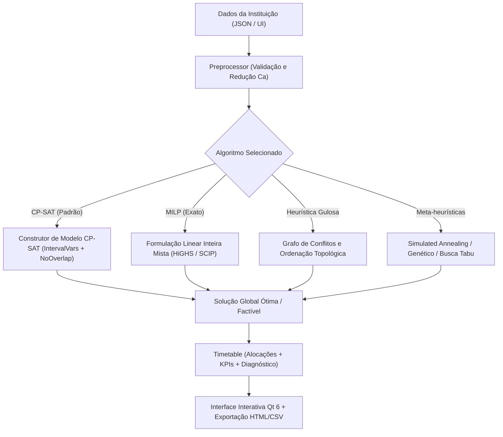

# Documentação do Modelo Matemático e Sistema de Escalonamento (EscalonadoEscalonador de horário)

---

## 1. Introdução e Visão Geral

O **Escalonador de horário** é um sistema computacional de alto desempenho desenvolvido para a resolução do **Problema de Programação de Horários Universitário e Escolar** (*High School and University Timetabling Problem*), classificado na literatura de complexidade como **NP-difícil** (*NP-hard*).

O núcleo do sistema foi implementado em **C++20** integrado ao ecossistema **Qt 6**, incorporando múltiplos paradigmas de resolução:
1. **Programação por Restrições (CP-SAT)** via Google OR-Tools, utilizando busca guiada por conflitos (*Conflict-Driven Clause Learning* - CDCL) e propagadores dedicados de intervalos (*Interval Constraints* e `NoOverlap`);
2. **Programação Linear Inteira Mista (MILP)** com formulações canônicas de fluxo e atribuição para solvers exatos (HiGHS e SCIP);
3. **Heurísticas Construtivas Gulosas** orientadas pela coloração e grau de conflito em grafos de adjacência;
4. **Meta-heurísticas Estocásticas**, incluindo *Simulated Annealing* (Recozimento Simulado), *Genetic Algorithm* (Algoritmo Genético com operadores de cruzamento compatíveis com restrições rígidas) e *Tabu Search* (Busca Tabu com memória de curto e médio prazo).

Uma das principais características do sistema é a diferenciação formal e simultânea entre **Disciplinas Anuais** e **Disciplinas Semestrais**, permitindo otimizações integradas com acoplamento intersemestral de horários e salas.

---

## 2. Discretização Temporal e Resolução em Slots

A fim de acomodar de forma exata e sem perdas de granularidade as diferentes durações de aulas comuns em instituições educacionais (aulas padrão de **45 minutos** do Ensino Fundamental/Médio e de **50 minutos** do Ensino Técnico/Superior), o sistema emprega a técnica de discretização baseada no **Máximo Divisor Comum (MDC)**:

$$\Delta = \operatorname{MDC}(45, 50) = 5 \text{ minutos}$$

### Representação em Slots Diários
Cada dia letivo é mapeado a partir das 00:00 como um conjunto ordenado de índices inteiros discretos $b \in B = \{0, 1, 2, \dots, N_{\text{slots}}-1\}$:

$$b(h, m) = \frac{h \times 60 + m}{\Delta} = \frac{h \times 60 + m}{5}$$

Um intervalo contínuo de tempo $[T_{\text{início}}, T_{\text{fim}})$ composto por $h_1:m_1$ até $h_2:m_2$ é discretizado como:

$$s = \frac{h_1 \times 60 + m_1}{5}, \quad e = \frac{h_2 \times 60 + m_2}{5}, \quad \text{Duração em slots: } L = e - s$$

* Uma aula de 45 minutos corresponde a $L = \frac{45}{5} = 9$ slots consecutivos.
* Uma aula de 50 minutos corresponde a $L = \frac{50}{5} = 10$ slots consecutivos.
* Um recreio/intervalo de 15 minutos corresponde a $L = 3$ slots; 20 minutos a $L = 4$ slots.

---

## 3. Conjuntos, Índices e Notação Matemática

| Conjunto | Símbolo | Descrição |
| :--- | :---: | :--- |
| **Professores** | $P$ | Conjunto de docentes disponíveis, indexados por $p \in P$. |
| **Turmas** | $T$ | Conjunto de turmas/agrupamentos de discentes, indexados por $t \in T$. |
| **Salas e Laboratórios** | $S$ | Conjunto de espaços físicos escolares, indexados por $r \in S$. Subdividido em $S^{\text{teo}}$ (salas teóricas) e $S^{\text{lab}}$ (laboratórios e salas especiais). |
| **Dias Letivos** | $D$ | Dias da semana, $d \in D = \{\text{SEG}, \text{TER}, \text{QUA}, \text{QUI}, \text{SEX}\}$ ($|D| = 5$). |
| **Slots Diários** | $B$ | Slots discretos de 5 minutos, $b \in B = \{0, 1, \dots, 287\}$. |
| **Semestres** | $\Sigma$ | Semestres do ano letivo, $s \in \Sigma = \{1, 2\}$. |
| **Regimes** | $\mathcal{R}$ | Regimes curriculares, $\mathcal{R} = \{\text{ANUAL}, \text{SEMESTRAL}\}$. |
| **Disciplinas** | $\mathcal{D}$ | Componentes curriculares cadastrados no projeto acadêmico. |
| **Ocorrências de Aulas** | $A$ | Conjunto de blocos/ocorrências de aulas a serem alocados, indexados por $a \in A$. |

---

## 4. Classificação de Disciplinas: Anuais vs. Semestrais

A matriz curricular de uma instituição abriga disciplinas com dinâmicas temporais e períodos de vigência distintos. O modelo matemático formaliza essa distinção da seguinte maneira:

### 4.1. Disciplinas Anuais ($\mathcal{R}_{\text{ANUAL}}$)
* **Vigência**: Vigoram de forma ininterrupta durante todo o ano letivo, compreendendo simultaneamente o **1º Semestre** ($s = 1$) e o **2º Semestre** ($s = 2$).
* **Acoplamento Matemático Intersemestral**: A grade escolar não pode sofrer rupturas para matérias anuais entre semestres. Portanto, uma disciplina anual alocada na Terça-feira às 08:00 na Sala 101 no 1º semestre deve **obrigatoriamente** permanecer alocada na Terça-feira às 08:00 na Sala 101 no 2º semestre:

$$x_{a, d, t, r}^{(1)} = x_{a, d, t, r}^{(2)} = x_{a, d, t, r}, \quad \forall a \in A \text{ tal que } \text{regime}(a) = \text{ANUAL}$$

No modelo de restrições do CP-SAT, isso é garantido de forma ultra-eficiente fazendo com que a mesma variável de intervalo $\text{IntervalVar}(a)$ participe concorrentemente das restrições de não-sobreposição (`NoOverlap`) tanto do 1º quanto do 2º semestre.

### 4.2. Disciplinas Semestrais ($\mathcal{R}_{\text{SEMESTRAL}}$)
* **Vigência**: Vigoram exclusivamente no semestre letivo para o qual foram planejadas:
  * $\text{Semestre}(a) = \text{SEMESTRE\_1} \implies \text{Ativa em } s = 1$.
  * $\text{Semestre}(a) = \text{SEMESTRE\_2} \implies \text{Ativa em } s = 2$.
* **Alternância e Reuso de Recursos**: Duas disciplinas semestrais alocadas para a mesma turma ou mesmo professor em semestres distintos **podem compartilhar perfeitamente o mesmo horário e a mesma sala física**. Por exemplo:
  * História (Semestral 1º Semestre) pode ocorrer na Segunda-feira das 08:00 às 09:40 na Sala 101;
  * Geografia (Semestral 2º Semestre) pode ocorrer na mesma Segunda-feira das 08:00 às 09:40 na mesma Sala 101;
  * Não há colisão, pois cada aula atua em partições temporais mutuamente exclusivas do calendário letivo.

### 4.3. Escopos de Otimização do Modelo

O sistema oferece 4 modos de escopo de resolução (`EscopoSemestreOtimizacao`):
1. **`TODAS_SEM_FILTRO` (Modo Canônico)**: Todas as aulas ativas são consideradas no mesmo horizonte temporal compartilhado.
2. **`SEMESTRE_1` (Foco no 1º Semestre)**: Aloca apenas aulas anuais e semestrais do 1º semestre. Disciplinas exclusivas do 2º semestre são desativadas.
3. **`SEMESTRE_2` (Foco no 2º Semestre)**: Aloca apenas aulas anuais e semestrais do 2º semestre.
4. **`AMBOS_INTEGRADO` (Otimização Anual Completa com Sincronização)**: Resolve o ano letivo completo simultaneamente em um único problema global:
   * Mantém a identidade exata de horários e salas para disciplinas anuais entre semestres;
   * Otimiza a alternância e preenchimento de vagas entre disciplinas do 1º e 2º semestres;
   * Garante a não-sobreposição isolada para cada semestre $s \in \{1, 2\}$.

---

## 5. Parâmetros do Problema

Para cada ocorrência de aula $a \in A$:
* $d_a \in \mathbb{N}$: Duração da aula expressa em número de slots ($d_a = \text{duracaoMinutos}(a) / \Delta$).
* $P_a \subseteq P$: Conjunto de professores responsáveis por ministrar a aula $a$ (suporta co-docência / *team teaching*).
* $T_a \subseteq T$: Conjunto de turmas que participam da aula $a$ (suporta aulas conjuntas / agrupamentos de turmas).
* $S_a \subseteq S$: Conjunto de salas alternativas permitidas para a aula $a$ (respeitando capacidade discente e laboratórios específicos).
* $\text{tipo}(a) \in \{\text{TEORICA}, \text{LABORATORIO}, \text{ESPECIAL}\}$: Classificação da aula.
* $\text{regime}(a) \in \{\text{ANUAL}, \text{SEMESTRAL}\}$: Regime curricular.
* $\text{semestre}(a) \in \{\text{SEMESTRE\_1}, \text{SEMESTRE\_2}, \text{AMBOS}\}$: Semestre ativo.
* $\text{fixada}(a) \in \{0, 1\}$: Indicador se a aula está previamente fixada (*pinned*) pelo usuário, com dia $\bar{d}_a$, slot $\bar{b}_a$ e sala $\bar{r}_a$.

Para cada professor $p \in P$:
* $\text{disp}_{p, d, b} \in \{0, 1\}$: Disponibilidade do professor $p$ no dia $d$ e slot $b$ ($1$ = disponível, $0$ = indisponível).
* $w_{p, d} \in [0, 10]$: Peso de preferência docente para lecionar no dia $d$ ($10$ = dia preferido, $0$ = dia indesejado).
* $\text{max\_dias}_p \in \{1, \dots, 5\}$: Número máximo desejado de dias de trabalho semanais para o professor $p$.

Para cada turma $t \in T$:
* $\text{turno}_{t, b} \in \{0, 1\}$: Indicador se o slot $b$ pertence ao turno de estudo da turma $t$ (Matutino: 07:00-12:30, Vespertino: 13:00-18:30, Noturno: 18:45-22:30).
* $\text{recesso}_{t, d} = \{[s_k, e_k)\}$: Conjunto de intervalos/recreios obrigatórios da turma $t$ no dia $d$.

### Geração de Candidatos Válidos ($C_a$)
Para otimizar o espaço de busca, o pré-processador analítico gera para cada aula $a \in A$ apenas as tuplas viáveis $(d, b, r) \in C_a$:
$$C_a = \left\{ (d, b, r) \in D \times B \times S_a \;\middle|\; \begin{aligned}
& [b, b + d_a) \subseteq \text{turno}(t), \quad \forall t \in T_a \\
& [b, b + d_a) \cap \text{recesso}(t) = \emptyset, \quad \forall t \in T_a \\
& \text{disp}_{p, d, b'} = 1, \quad \forall p \in P_a, \; \forall b' \in [b, b + d_a) \\
& \text{capacidade}(r) \ge \sum_{t \in T_a} \text{alunos}(t)
\end{aligned} \right\}$$

---

## 6. Variáveis de Decisão

### 6.1. Variáveis Primárias de Alocação
Para cada aula $a \in A$ e cada candidato viável $(d, b, r) \in C_a$:

$$x_{a, d, b, r} \in \{0, 1\}$$

onde $x_{a, d, b, r} = 1$ se a aula $a$ for alocada no dia $d$, iniciando no slot $b$, utilizando a sala $r$; e $0$ caso contrário.

### 6.2. Variáveis de Intervalo do CP-SAT
No solver CP-SAT, modela-se cada aula $a$ como uma coleção de variáveis de intervalo opcionais:

$$I_{a, d, b, r} = \operatorname{NewOptionalIntervalVar}(b, d_a, b + d_a, x_{a, d, b, r})$$

### 6.3. Variáveis de Sala Teórica Fixa da Turma
Para cada turma $t \in T$ e cada sala teórica candidata $r \in S^{\text{teo}}$:

$$z_{t, r} \in \{0, 1\}$$

onde $z_{t, r} = 1$ se a sala $r$ for escolhida como a sala fixa permanente de aula teórica da turma $t$; e $0$ caso contrário.

### 6.4. Variáveis Auxiliares de Otimização (Soft Constraints)
* $u_{p, d} \in \{0, 1\}$: Indica se o professor $p$ leciona no dia $d$.
* $u_{t, d} \in \{0, 1\}$: Indica se a turma $t$ tem aulas no dia $d$.
* $\operatorname{start}_{p, d}, \operatorname{end}_{p, d} \in B$: Slots do início da primeira aula e do término da última aula do professor $p$ no dia $d$.
* $\operatorname{span}_{p, d} = \operatorname{end}_{p, d} - \operatorname{start}_{p, d}$: Amplitude total de permanência do professor na escola no dia $d$.
* $\operatorname{worked\_slots}_{p, d} \in B$: Total efetivo de slots de aula lecionados pelo professor $p$ no dia $d$.
* $\operatorname{gap}_{p, d} = \operatorname{span}_{p, d} - \operatorname{worked\_slots}_{p, d}$: Quantidade de slots em janelas (horários vagos ociosos entre aulas).

---

## 7. Restrições Rígidas (*Hard Constraints*)

Todas as soluções geradas pelo sistema satisfazem estritamente o conjunto de restrições rígidas abaixo. Qualquer violação torna o cronograma inviável.

### R1. Alocação Única por Aula
Cada ocorrência de aula cadastrada deve ser alocada exatamente uma vez em um dia, horário e sala válidos:

$$\sum_{(d, b, r) \in C_a} x_{a, d, b, r} = 1, \quad \forall a \in A$$

### R2. Não-Sobreposição de Horários de Professores por Semestre
Nenhum professor pode ministrar mais de uma aula simultaneamente no mesmo dia e slot temporal. A restrição atua separadamente em cada semestre $s \in \{1, 2\}$:

$$\operatorname{NoOverlap}\left( \left\{ I_{a, d, b, r} \;\middle|\; a \in A, \, p \in P_a, \, \text{ativo}(a, s), \, (d, b, r) \in C_a \right\} \right), \quad \forall p \in P, \; \forall d \in D, \; \forall s \in \{1, 2\}$$

*Para disciplinas anuais, a mesma variável de intervalo $I_{a, d, b, r}$ participa de ambas as restrições ($s = 1$ e $s = 2$), garantindo identidade anual sem conflitos.*

### R3. Não-Sobreposição de Horários de Turmas e Recreios por Semestre
Nenhuma turma pode ter duas aulas no mesmo horário, e nenhuma aula pode colidir com o intervalo/recreio fixo da turma:

$$\operatorname{NoOverlap}\left( \left\{ I_{a, d, b, r} \;\middle|\; a \in A, \, t \in T_a, \, \text{ativo}(a, s), \, (d, b, r) \in C_a \right\} \cup \text{Recessos}(t, d) \right), \quad \forall t \in T, \; \forall d \in D, \; \forall s \in \{1, 2\}$$

### R4. Não-Sobreposição de Ocupação de Salas e Laboratórios por Semestre
Nenhum espaço físico (sala comum ou laboratório) pode receber mais de uma turma no mesmo dia e horário:

$$\operatorname{NoOverlap}\left( \left\{ I_{a, d, b, r} \;\middle|\; a \in A, \, \text{ativo}(a, s), \, (d, b, r) \in C_a \text{ com sala } r \right\} \right), \quad \forall r \in S, \; \forall d \in D, \; \forall s \in \{1, 2\}$$

### R5. Consistência de Sala Teórica Fixa por Turma
Todas as aulas de natureza teórica de uma turma $t$ devem ocorrer na mesma sala fixa designada para ela, poupando os alunos de deslocamentos desnecessários:

$$\sum_{r \in S^{\text{teo}}} z_{t, r} = 1, \quad \forall t \in T$$

$$x_{a, d, b, r} \le z_{t, r}, \quad \forall a \in A \text{ com } \text{tipo}(a) = \text{TEORICA}, \; t \in T_a, \; (d, b, r) \in C_a$$

Se a instituição já definiu previamente uma sala teórica física para a turma ($r^*$), fixa-se $z_{t, r^*} = 1$ e $z_{t, r} = 0, \forall r \neq r^*$.

### R6. Compatibilidade de Tipos de Sala e Capacidade
Aulas práticas de laboratório ($\text{tipo}(a) = \text{LABORATORIO}$) só podem ser alocadas em salas do subconjunto $S^{\text{lab}}$ devidamente habilitadas para a disciplina, com capacidade física de assentos $\ge \text{alunos}(t)$. Esta restrição é garantida por construção no domínio $C_a$.

### R7. Respeito a Aulas Fixadas (*Pinning*)
Se o usuário fixou manualmente uma aula $a$ na interface gráfica no dia $\bar{d}$, horário $\bar{b}$ e sala $\bar{r}$, o modelo impõe:

$$x_{a, \bar{d}, \bar{b}, \bar{r}} = 1$$

e remove todos os demais candidatos de $C_a$.

### R8. Limite Máximo de Aulas Diárias da Mesma Disciplina
Para resguardar o equilíbrio pedagógico dos alunos, uma disciplina $k \in \mathcal{D}$ não deve concentrar mais de $M_{\text{diário}}$ ocorrências de aula na mesma turma no mesmo dia (geralmente $M_{\text{diário}} = 2$ para aulas geminadas):

$$\sum_{a \in A_k} \sum_{(d, b, r) \in C_a} x_{a, d, b, r} \le M_{\text{diário}}, \quad \forall d \in D, \; \forall k \in \mathcal{D}, \; \forall t \in T$$

---

## 8. Função Objetivo Multicritério (*Soft Constraints*)

A função objetivo minimiza uma soma ponderada de critérios de qualidade pedagógica e conforto docente:

$$\min Z = \lambda_1 \cdot J_{\text{prof}} + \lambda_2 \cdot D_{\text{prof}} + \lambda_3 \cdot P_{\text{prof}} + \lambda_4 \cdot J_{\text{turma}} + \lambda_5 \cdot W_{\text{prof\_dias}} + \lambda_6 \cdot T_{\text{prof\_turnos}} + \dots$$

onde os parâmetros de peso $\lambda_i \ge 0$ são customizados pelo usuário na tela de configuração.

---

### 8.1. Minimização de Janelas de Professores ($J_{\text{prof}}$) Quebrada por Turno e Ponderada pelo Professor
A minimização de janelas é calculada separadamente para cada professor $p \in P$, dia $d \in D$ e turno $s \in \{\text{MANHA}, \text{TARDE}, \text{NOITE}\}$. Isso assegura que pausas normais entre turnos diferentes (como o intervalo entre o período matutino e o noturno) não sejam indevidamente penalizadas como janelas.

Além disso, a penalidade é proporcional ao peso individual de aversão a janelas informado pelo próprio docente ($\alpha_p \in [0, 10]$):
- Se $\alpha_p = 0$, o docente é indiferente a janelas (custo zero na função objetivo);
- Se $\alpha_p = 10$, a aversão a janelas é máxima.

$$J_{\text{prof}} = \sum_{p \in P} \alpha_p \sum_{d \in D} \sum_{s \in S} \operatorname{gap}_{p, d, s}$$

O CP-SAT lineariza eficientemente essa relação dentro de cada turno utilizando as variáveis de precedência e sucessão $u, v$ e presença $w_k$:
$$g_{p, d, s, k} \ge u_{p, d, s, k} + v_{p, d, s, k} - 1 - w_{p, d, s, k}$$

### 8.2. Respeito aos Turnos Pretendidos pelo Professor ($T_{\text{prof\_turnos}}$)
Cada professor pode indicar, para cada dia da semana, quais turnos pretende trabalhar. Caso o solver necessite alocar o professor em um turno que ele não pretendeu naquele dia, uma penalidade é aplicada na função objetivo:

$$T_{\text{prof\_turnos}} = \sum_{p \in P} \sum_{d \in D} \sum_{\substack{s \in S \\ s \notin \text{pretendidos}(p, d)}} y_{p, d, s}$$

onde $y_{p, d, s} \in \{0, 1\}$ indica se o professor $p$ leciona no turno $s$ do dia $d$.

### 8.3. Minimização de Dias Trabalhados e Agrupamento da Jornada Docente ($D_{\text{prof}}$)
Evita que um professor tenha que comparecer à instituição por apenas um horário esporádico em um dia, compactando sua carga horária no menor número de dias possível:

$$D_{\text{prof}} = \sum_{p \in P} \sum_{d \in D} u_{p, d}$$

sujeito a:
$$u_{p, d} \ge x_{a, d, b, r}, \quad \forall a \in A, \, p \in P_a, \, (d, b, r) \in C_a$$

### 8.4. Respeito às Preferências de Dias da Semana dos Docentes ($W_{\text{prof\_dias}}$)
Cada professor pode declarar notas de 0 a 10 para cada dia da semana. Dias com peso baixo acarretam penalidade na função objetivo:

$$W_{\text{prof\_dias}} = \sum_{p \in P} \sum_{d \in D} (10 - w_{p, d}) \cdot u_{p, d}$$

### 8.5. Minimização de Janelas e Buracos nas Turmas ($J_{\text{turma}}$)
Garante que a grade das turmas seja compacta, sem aulas "vagas" entre aulas regulares:

$$J_{\text{turma}} = \sum_{t \in T} \sum_{d \in D} (\operatorname{span}_{t, d} - \operatorname{worked\_slots}_{t, d} - \operatorname{recesso\_slots}_{t, d})$$

### 8.6. Estabilidade e Proximidade à Grade Atual / Warm Start ($W_{\text{warm\_start}}$)
Quando o usuário aciona o modo de re-otimização a partir da grade atual, o solver penaliza alterações em relação às aulas já posicionadas na tela $(\bar{d}_a, \bar{b}_a, \bar{r}_a)$:

$$W_{\text{warm\_start}} = \sum_{a \in A_{\text{existente}}} \sum_{\substack{(d, b, r) \in C_a \\ (d, b, r) \neq (\bar{d}_a, \bar{b}_a, \bar{r}_a)}} x_{a, d, b, r}$$

Isso assegura que pequenos ajustes manuais não destruam a estrutura do restante da grade.

### 8.7. Minimização de Troca de Salas e Uso de Salas Secundárias ($C_{\text{salas}}$)
Penaliza o uso de salas reservas ou alternativas quando a sala ideal de menor custo está disponível:

$$C_{\text{salas}} = \sum_{a \in A} \sum_{(d, b, r) \in C_a} \operatorname{custo}(r) \cdot x_{a, d, b, r}$$

---

## 9. Algoritmos e Métodos de Resolução Implementados

### 9.1. Google OR-Tools CP-SAT (Recomendado)
* **Vantagens**: Propagadores globais dedicados para intervalos (`AddNoOverlap`), busca baseada em conflitos (SAT-solvers), suporte a paralelismo com múltiplos *workers* e tempo determinístico com *hints* de Warm Start.
* **Complexidade Prática**: Resolve cenários de grande porte (60 a 500 aulas) em segundos a poucos minutos.

### 9.2. MILP Canônico (HiGHS / SCIP)
* Converte a formulação para restrições lineares clássicas $A x \le b$, resolvido via *Branch-and-Cut* e métodos Simplex Duais.

### 9.3. Heurística Construtiva Gulosa (*Greedy Conflict-Degree Ordering*)
1. Ordena as ocorrências de aula $a \in A$ em ordem decrescente de dificuldade (grau de conflito com professores, salas escassas e turmas);
2. Para cada aula, avalia todas as tuplas $(d, b, r) \in C_a$ livres de colisão;
3. Escolhe a tupla que minimiza localmente o incremento de janelas e dias trabalhados;
4. Executa em menos de **100 ms**, servindo também como ponto de partida inicial (*seed*) para meta-heurísticas.

### 9.4. Meta-heurísticas Estocásticas
* **Simulated Annealing**: Utiliza temperatura inicial $T_0$ e decaimento geométrico $T_{k+1} = \alpha T_k$ com operadores de troca de horário, troca de sala e permuta de pares de aulas.
* **Algoritmo Genético**: População de cromossomos onde cada gene representa uma tupla de alocação, aplicando cruzamento uniforme e mutação de reparo para não violar restrições rígidas.
* **Busca Tabu**: Explora a vizinhança de 1-troca mantendo uma lista tabu FIFO com as últimas $K$ inversões de alocação proibidas, superadas apenas por critério de aspiração.

---

## 10. Mapeamento da Arquitetura Orientada a Objetos

| Classe / Estrutura | Arquivo | Responsabilidade |
| :--- | :--- | :--- |
| `RegimeDisciplina` | `include/model/Lesson.h` | Enum que define se a disciplina é `ANUAL` ou `SEMESTRAL`. |
| `SemestreLetivo` | `include/model/Lesson.h` | Enum com os semestres `SEMESTRE_1`, `SEMESTRE_2` e `AMBOS`. |
| `Disciplina` | `include/model/Lesson.h` | Dados mestre da disciplina (nome, carga horária, regime, semestre, tipo, professores, salas). |
| `Lesson` | `include/model/Lesson.h` | Ocorrência individual de aula gerada a partir da carga horária semanal. |
| `AllocatedLesson` | `include/model/Timetable.h` | Aula posicionada na grade, contendo dia, intervalo de slots, sala e semestre de alocação. |
| `Timetable` | `include/model/Timetable.h` | Grade horária completa, estatísticas de execução (status, tempo, penalidades $J, D, W, J_G$). |
| `OptimizationConfig`| `include/model/OptimizationConfig.h`| Configuração da otimização: pesos $\lambda_i$, algoritmo, escopo semestral e timeout. |
| `InstitutionData` | `include/model/InstitutionData.h` | Repositório central de dados com geradores dinâmicos de ID (`nextProfessorId`, `nextTurmaId`, etc.). |
| `Preprocessor` | `src/solver/Preprocessor.cpp` | Validação de consistência, cálculo de $C_a$ e detecção prévia de inviabilidade. |
| `ScheduleSolver` | `src/solver/ScheduleSolver.cpp` | Motor de resolução matemática (CP-SAT, MILP, Heurística e Meta-heurísticas). |
| `MainWindow` | `src/ui/MainWindow.cpp` | Janela principal com tabelas de seleção estendida, KPIs, atalhos de remoção e orquestração. |
| `ProfessorEditorDialog`| `include/ui/ProfessorEditorDialog.h`| Diálogo com abas ergonômicas de disponibilidade semanal, presets rápidos, preferências e aversão a janelas. |
| `TurmaEditorDialog` | `include/ui/TurmaEditorDialog.h` | Diálogo com abas de jornadas diárias, múltiplos intervalos de recesso, presets e vínculo de sala teórica fixa. |
| `RoomEditorDialog` | `include/ui/RoomEditorDialog.h` | Diálogo simplificado de cadastro de salas e laboratórios com tipos de ambiente e capacidade. |
| `LessonEditorDialog`| `include/ui/LessonEditorDialog.h`| Diálogo de cadastro de disciplinas com seletores nominais limpos e salas alternativas. |
| `TableSearchSortBar`| `include/ui/TableSearchSortBar.h`| Barra reativa de busca em tempo real e ordenação alfanumérica com filtro automático de colunas visíveis. |
| `TimetableView` | `src/ui/TimetableView.cpp` | Visualizador interativo de grade semanal com filtro por semestre, busca e pinning. |
| `JsonSerialization`| `src/serialization/JsonSerialization.cpp` | Persistência e leitura do projeto completo em formato JSON padronizado. |
| `ScheduleReportExporter`| `src/ui/ScheduleReportExporter.cpp`| Exportador de relatórios em HTML estilizado com badges semestrais e CSV analítico. |
| `ModernTheme` | `src/ui/ModernTheme.cpp` | Design System dark moderno, controle visual de comboboxes com setas SVG e scrollbars confortáveis. |

---

## 11. Gestão Dinâmica de Dados e Experiência do Usuário (CRUD Moderno)

A fim de elevar o sistema a um padrão profissional de uso diário, o gerenciamento de dados e a interface gráfica foram totalmente desacoplados da rigidez de códigos internos:

### 11.1. Geração Dinâmica e Automática de IDs
* **Transparência e Autonomia**: O usuário final não necessita mais inventar, digitar ou gerenciar códigos de identificação (`ID`).
* **Algoritmo Incremental Livre de Colisões**:
  * Implementados na classe `InstitutionData`:
    * `nextProfessorId()` $\implies$ gera códigos sequenciais com prefixo `P` (`P01`, `P02`, etc.);
    * `nextTurmaId()` $\implies$ gera códigos sequenciais com prefixo `T` (`T01`, `T02`, etc.);
    * `nextSalaId()` $\implies$ gera códigos sequenciais com prefixo `S` (`S01`, `S02`, etc.);
    * `nextDisciplinaId()` $\implies$ gera códigos sequenciais com prefixo `D` (`D01`, `D02`, etc.).
  * O algoritmo examina os sufixos numéricos de todos os registros existentes, localiza o valor máximo e gera o próximo identificador vago, validando a inexistência de duplicidade via `find...()`.
  * Essa abordagem preserva integralmente a integridade relacional do modelo matemático e das referências em arquivos JSON (`disciplina.professor_id`, `lesson.turma_id`, `lesson.sala_id`) sem onerar o operador humano.

### 11.2. Ocultação Total de IDs e Limpeza Visual
* **Tabelas de Cadastro**: Nas 4 tabelas centrais da `MainWindow` (Professores, Turmas, Salas e Disciplinas), a coluna primária que armazena o ID técnico permanece ativa em memória, porém é ocultada visualmente via `setColumnHidden(0, true)`.
* **Formulários de Edição**: Todos os campos de texto que solicitavam "Código (ID)" foram removidos dos diálogos (`ProfessorEditorDialog`, `TurmaEditorDialog`, `RoomEditorDialog` e `LessonEditorDialog`). O foco do cadastro volta-se exclusivamente para os atributos de negócio: Nome, Turno, Jornada, Carga e Tipo de Ambiente.
* **Seletores Nominais Amigáveis**: Dropdowns (`QComboBox`) e listas (`QListWidget`) exibem exclusivamente nomes legíveis (ex: `"Prof. Carlos Silva (Matemática)"`, `"1º Ano A - Ensino Médio"`, `"Laboratório de Informática"`), eliminando a poluição visual de colchetes e códigos como `[P01]`, `[T01]` ou `[LAB_INF]`.
* **Busca e Ordenação Inteligente**: O componente `TableSearchSortBar` ignora automaticamente colunas ocultas, oferecendo ordenação e filtragem restritas às colunas perceptíveis pelo usuário.

### 11.3. Remoção em Massa de Dados (*Batch Deletion*)
* **Seleção Estendida Multirregistro**: As 4 tabelas de dados operam em modo `QAbstractItemView::ExtendedSelection`, habilitando seleções múltiplas contíguas (<kbd>Shift</kbd> + clique) ou intercaladas (<kbd>Ctrl</kbd> + clique), além do atalho universal de seleção total (<kbd>Ctrl</kbd> + <kbd>A</kbd>).
* **Atalho Rápido do Teclado**: O acionamento da tecla <kbd>Delete</kbd> em qualquer tabela dispara imediatamente o fluxo de exclusão da seleção ativa.
* **Confirmação Amigável e Contextual**:
  * Para **1 registro**: exibe o nome individual da entidade (ex: *"Deseja realmente remover o professor 'Carlos Silva'?"*).
  * Para **múltiplos registros**: informa o total exato de itens e lista nominalmente até os 8 primeiros selecionados (ex: *"Deseja realmente remover os 5 professores selecionados em massa? • Carlos Silva • Ana Souza..."*).
* **Sincronização em Cascata**: A exclusão em lote atualiza instantaneamente as dependências entre disciplinas, ocorrências de aulas e a grade horária vigente.

### 11.4. Ergonomia e Acessibilidade dos Editores
* **`ProfessorEditorDialog`**:
  * Estruturação em duas abas: `⏰ Horários de Disponibilidade` (Aba 1) e `⭐ Turnos Pretendidos & Preferências` (Aba 2).
  * Botões de preenchimento rápido em um clique: **Manhã**, **Tarde**, **Integral**, **Noite**, **Dia Todo** e **Limpar Todos**.
  * Tabela de intervalos com rolagem suave e dimensão expandida, garantindo acesso completo aos seletores de dias e horas de início e término.
* **`TurmaEditorDialog`**:
  * Separação entre `📅 Horários & Jornadas por Dia` e `🏛️ Sala Teórica Permanente`.
  * Configuração diária com suporte a até 3 intervalos de recesso/recreio por dia, cálculo automático de minutos letivos e botões para replicar horários entre os dias da semana.

---

## 12. Visão Geral do Modelo Completo e Catálogo de Restrições

Esta seção consolida a formalização matemática integral do **Escalonador de horário**. O problema de programação de horários é formulado como uma otimização com restrições rígidas inegociáveis e critérios de preferência configuráveis.

Para facilitar a distinção:
* **Restrições Rígidas (*Hard Constraints*)**: Devem ser estritamente atendidas. Caso alguma seja violada, a grade é considerada matematicamente infactível (*Infeasible*).
* ***Restrições Opcionais / Flexíveis (Soft Constraints & Configurações)***: *Destacadas em itálico e em azul*. Podem ser ativadas, desativadas ou ter seus pesos penalizadores ajustados pelo usuário na interface gráfica conforme a política pedagógica da instituição.

---

### 12.1. Formulação Canônica Unificada

$$\min \quad Z = \sum_{k} \lambda_k \cdot \Phi_k(x, y, z)$$

$$\text{sujeito a:}$$

$$\begin{cases}
\text{Restrições Rígidas (H1 a H11)} & \implies \text{Obrigatórias em todas as resoluções} \\
\color{#0284c7}{\text{\textit{Restrições Opcionais e Critérios Flexíveis (O1 a O11)}}} & \implies \color{#0284c7}{\text{\textit{Configuradas via Interface / Painel de Parâmetros}}}
\end{cases}$$

---

### 12.2. Catálogo Detalhado de Todas as Restrições

#### [H1] Alocação Única e Completa de Cada Aula
* **Classificação**: **Restrição Rígida (*Hard*)**
* **Descrição**: Toda ocorrência de aula $a \in A$ pertencente à matriz curricular da instituição deve ser alocada exatamente uma vez em uma combinação de dia, horário e espaço físico admissível.
* **Equação**:
  $$\sum_{(d, b, r) \in C_a} x_{a, d, b, r} = 1, \quad \forall a \in A$$

#### [H2] Não-Sobreposição de Horários de Professores (por Semestre)
* **Classificação**: **Restrição Rígida (*Hard*)**
* **Descrição**: Um professor jamais pode ministrar duas aulas no mesmo dia e slot horário no mesmo semestre. Para disciplinas anuais, a mesma variável de alocação atua em ambos os semestres.
* **Equação**:
  $$\operatorname{NoOverlap}\left( \left\{ I_{a, d, b, r} \;\middle|\; a \in A, \, p \in P_a, \, \text{ativo}(a, s), \, (d, b, r) \in C_a \right\} \right), \quad \forall p \in P, \; \forall d \in D, \; \forall s \in \{1, 2\}$$

#### [H3] Não-Sobreposição de Turmas e Respeito a Recessos/Intervalos (por Semestre)
* **Classificação**: **Restrição Rígida (*Hard*)**
* **Descrição**: Uma turma jamais pode assistir a duas aulas simultâneas, e nenhuma aula pode sobrepor os horários de recesso/recreio definidos na jornada da turma.
* **Equação**:
  $$\operatorname{NoOverlap}\left( \left\{ I_{a, d, b, r} \;\middle|\; a \in A, \, t \in T_a, \, \text{ativo}(a, s), \, (d, b, r) \in C_a \right\} \cup \text{Recessos}(t, d) \right), \quad \forall t \in T, \; \forall d \in D, \; \forall s \in \{1, 2\}$$

#### [H4] Não-Sobreposição de Ocupação de Salas e Ambientes (por Semestre)
* **Classificação**: **Restrição Rígida (*Hard*)**
* **Descrição**: Um espaço físico (sala teórica ou laboratório) só pode abrigar uma turma por vez no mesmo horário.
* **Equação**:
  $$\operatorname{NoOverlap}\left( \left\{ I_{a, d, b, r} \;\middle|\; a \in A, \, \text{ativo}(a, s), \, (d, b, r) \in C_a \text{ com sala } r \right\} \right), \quad \forall r \in S, \; \forall d \in D, \; \forall s \in \{1, 2\}$$

#### [H5] Consistência de Sala Teórica Fixa por Turma
* **Classificação**: **Restrição Rígida (*Hard*)**
* **Descrição**: Toda turma possui uma única sala teórica permanente durante todo o ano letivo. Todas as aulas teóricas da turma devem ocorrer estritamente nessa sala.
* **Equação**:
  $$\sum_{r \in S^{\text{teo}}} z_{t, r} = 1, \quad \forall t \in T$$
  $$x_{a, d, b, r} \le z_{t, r}, \quad \forall a \in A \text{ com } \text{tipo}(a) = \text{TEORICA}, \; t \in T_a, \; (d, b, r) \in C_a$$

#### [H6] Habilitação de Salas, Laboratórios e Capacidade Discente
* **Classificação**: **Restrição Rígida (*Hard*)**
* **Descrição**: Aulas laboratoriais ou especiais só podem ocupar salas com os recursos tecnológicos exigidos, e a capacidade física de assentos deve comportar o total de discentes inscritos.
* **Garantia**: Construída formalmente na filtragem do domínio de candidatos $C_a$.

#### [H7] Respeito Incondicional a Aulas Fixadas Manualmente (*Pinning*)
* **Classificação**: **Restrição Rígida (*Hard*)**
* **Descrição**: Se o usuário travou uma aula em determinado horário e sala na interface gráfica, essa escolha é respeitada compulsoriamente pelo otimizador.
* **Equação**:
  $$x_{a, \bar{d}, \bar{b}, \bar{r}} = 1, \quad \forall a \text{ fixada pelo usuário}$$

#### [H8] Teto da Carga Horária Máxima Diária por Docente
* **Classificação**: **Restrição Rígida (*Hard*)**
* **Descrição**: Um professor não pode ultrapassar o limite máximo de minutos de aula contratados por dia ($\text{cargaMax}(p)$).
* **Equação**:
  $$\sum_{a \in A \,:\, p \in P_a} \sum_{(d, b, r) \in C_a} \text{duracao}(a) \cdot x_{a, d, b, r} \le \text{cargaMax}(p), \quad \forall p \in P, \; \forall d \in D$$

#### [H9] Acoplamento e Identidade Intersemestral de Disciplinas Anuais
* **Classificação**: **Restrição Rígida (*Hard*)**
* **Descrição**: Disciplinas de regime anual mantêm exatamente o mesmo dia, horário e sala física em ambos os semestres letivos, garantindo a estabilidade pedagógica escolar.
* **Equação**:
  $$x_{a, d, b, r}^{(s=1)} = x_{a, d, b, r}^{(s=2)}, \quad \forall a \in A \text{ tal que } \text{regime}(a) = \text{ANUAL}$$

#### [H10] Respeito à Janela de Disponibilidade Docente e Turno da Turma
* **Classificação**: **Restrição Rígida (*Hard*)**
* **Descrição**: Professores só lecionam nos intervalos horários em que se declararam disponíveis. Aulas de uma turma devem estar contidas no turno em que ela funciona.
* **Garantia**: Garantida por construção no espaço viável $C_a$.

#### [H11] Início Obrigatório da Primeira Aula no Início da Jornada da Turma
* **Classificação**: **Restrição Rígida (*Hard*)**
* **Descrição**: Toda turma com aulas em determinado dia letivo deve obrigatoriamente iniciar suas atividades escolares no horário de início de sua jornada ($T^{ini}_{t,d}$). Aulas posteriores no mesmo dia só podem ocorrer se houver uma aula alocada no início da jornada. Essa restrição elimina simetrias de deslocamento temporal e acelera expressivamente a velocidade de convergência e desempenho do solver.
* **Equação**:
  $$x_{a, d, b, r} \le \sum_{a' \in A \,:\, t \in T_{a'}} \sum_{\substack{(d, b', r') \in C_{a'} \\ b' = T^{ini}_{t, d}}} x_{a', d, b', r'}, \quad \forall t \in T, \; \forall d \in \text{dias}(t), \; \forall a \in A \text{ com } t \in T_a, \; \forall (d, b, r) \in C_a \text{ com } b > T^{ini}_{t, d}$$

---

#### *[O1] Preenchimento Integral da Jornada da Turma*
* **Classificação**: ***Restrição Rígida Opcional (Ativada pelo Usuário)***
* **Descrição**: *Quando ativada na aba de parâmetros (`preenchimento_integral_jornada = true`), impõe que absolutamente todos os slots letivos da jornada diária da turma estejam cobertos por aulas, proibindo qualquer término antecipado ou início postergado.*
* **Equação**:
  $$\color{#0284c7}{\sum_{a \in A \,:\, t \in T_a} \sum_{\substack{(d, b, r) \in C_a \\ b \le k < b + d_a}} x_{a, d, b, r} = 1, \quad \forall t \in T, \; \forall d \in \text{dias}(t), \; \forall k \in \text{slotsLetivos}(t, d)}$$

#### *[O2] Limite Máximo de Aulas da Mesma Disciplina por Dia para a Turma*
* **Classificação**: ***Restrição Opcional / Configurável (Hard/Soft)***
* **Descrição**: *Evita que uma mesma disciplina concentre muitas aulas em um único dia para a turma (teto padrão de 2 aulas diárias, permitindo aulas geminadas).*
* **Equação**:
  $$\color{#0284c7}{\sum_{a \in A_k} \sum_{(d, b, r) \in C_a} x_{a, d, b, r} \le M_{\text{diário}}(k), \quad \forall d \in D, \; \forall k \in \mathcal{D}, \; \forall t \in T_k}$$

#### *[O3] Agrupamento de Aulas em Blocos Consecutivos (Aulas Geminadas)*
* **Classificação**: ***Restrição Opcional por Disciplina (Configurável no Cadastro)***
* **Descrição**: *Quando marcado no cadastro da disciplina (`exigirAulasConsecutivas = true`), o solver força que as aulas semanais ocorram agrupadas em blocos contínuos (ex: disciplina de 4 aulas ocorre em 1 bloco de 4 aulas no mesmo dia; disciplina de 8 aulas ocorre em 2 blocos de 4 aulas em 2 dias).*
* **Equação**:
  $$\color{#0284c7}{\sum_{a \in A_k} \sum_{(d, b, r) \in C_a} x_{a, d, b, r} = B_{\text{tamanho}} \cdot w_{k, d}, \quad \text{onde } w_{k, d} \in \{0, 1\} \text{ e } \sum_{d} w_{k, d} = N_{\text{blocos}}}$$

#### *[O4] Minimização de Janelas de Professores Ponderada por Turno e por Preferência Docente*
* **Classificação**: ***Critério Flexível (Soft Constraint) — Peso $\lambda_1$***
* **Descrição**: *Minimiza os horários vagos ociosos entre aulas do docente. O cálculo é particionado por turno (evitando penalizar a transição natural entre tarde e noite) e ponderado pela sensibilidade individual a janelas informada pelo próprio professor ($\alpha_p \in [0, 10]$).*
* **Termo da Função Objetivo**:
  $$\color{#0284c7}{J_{\text{prof}} = \sum_{p \in P} \alpha_p \sum_{d \in D} \sum_{\text{turno}} \operatorname{gap}_{p, d, \text{turno}}}$$

#### *[O5] Respeito aos Turnos Pretendidos pelo Professor por Dia da Semana*
* **Classificação**: ***Critério Flexível (Soft Constraint) — Peso $\lambda_5$***
* **Descrição**: *Aplica penalidade sempre que o otimizador precisa alocar um professor em um turno em que ele indicou não pretender lecionar naquele dia da semana.*
* **Termo da Função Objetivo**:
  $$\color{#0284c7}{T_{\text{prof\_turnos}} = \sum_{p \in P} \sum_{d \in D} \sum_{\substack{\text{turno} \\ \text{turno} \notin \text{pretendidos}(p, d)}} y_{p, d, \text{turno}}}$$

#### *[O6] Minimização de Dias Trabalhados e Compactação da Jornada Docente*
* **Classificação**: ***Critério Flexível (Soft Constraint) — Peso $\lambda_2$***
* **Descrição**: *Compacta a carga de trabalho do professor no menor número possível de dias da semana, desestimulando idas à instituição para ministrar apenas uma aula esparsa.*
* **Termo da Função Objetivo**:
  $$\color{#0284c7}{D_{\text{prof}} = \sum_{p \in P} \sum_{d \in D} y_{p, d}, \quad \text{onde } y_{p, d} \ge x_{a, d, b, r}}$$

#### *[O7] Respeito às Notas de Preferência de Dias da Semana dos Docentes*
* **Classificação**: ***Critério Flexível (Soft Constraint) — Peso $\lambda_4$***
* **Descrição**: *Prioriza a alocação dos professores em seus dias favoritos (peso 10) e penaliza dias menos desejados (peso 0 a 9) declarados individualmente na interface.*
* **Termo da Função Objetivo**:
  $$\color{#0284c7}{W_{\text{prof\_dias}} = \sum_{p \in P} \sum_{d \in D} (10 - w_{p, d}) \cdot y_{p, d}}$$

#### *[O8] Minimização de Lacunas e Horários Vagos nas Turmas*
* **Classificação**: ***Critério Flexível (Soft Constraint) — Peso $\lambda_6$***
* **Descrição**: *Evita que estudantes tenham aulas vazias no meio de suas atividades diárias, garantindo uma rotina escolar compacta e coesa.*
* **Termo da Função Objetivo**:
  $$\color{#0284c7}{J_{\text{turma}} = \sum_{t \in T} \sum_{d \in D} \operatorname{lacunas}_{t, d}}$$

#### *[O9] Minimização de Custo de Alocação de Horários e Preferências Gerais*
* **Classificação**: ***Critério Flexível (Soft Constraint) — Peso $\lambda_3$***
* **Descrição**: *Penaliza a alocação de disciplinas em horários desfavoráveis pedagogicamente.*
* **Termo da Função Objetivo**:
  $$\color{#0284c7}{P_{\text{custo}} = \sum_{a \in A} \sum_{(d, b, r) \in C_a} \operatorname{custo}(d, b) \cdot x_{a, d, b, r}}$$

#### *[O10] Estabilidade em Relação à Grade Vigente na Tela (Warm Start)*
* **Classificação**: ***Critério Flexível (Soft Constraint / Re-otimização)***
* **Descrição**: *Em processos de re-otimização, penaliza alterações desnecessárias nas aulas que já estavam confortavelmente posicionadas, preservando o histórico da instituição.*
* **Termo da Função Objetivo**:
  $$\color{#0284c7}{W_{\text{warm\_start}} = \sum_{a} \sum_{\substack{(d, b, r) \\ (d, b, r) \neq (\bar{d}_a, \bar{b}_a, \bar{r}_a)}} x_{a, d, b, r}}$$

#### *[O11] Minimização de Troca de Salas e Uso de Ambientes Secundários*
* **Classificação**: ***Critério Flexível (Soft Constraint)***
* **Descrição**: *Privilegia a sala de preferência prioritária da disciplina e penaliza o uso de salas reservas.*
* **Termo da Função Objetivo**:
  $$\color{#0284c7}{C_{\text{salas}} = \sum_{a \in A} \sum_{(d, b, r) \in C_a} \operatorname{custo}(r) \cdot x_{a, d, b, r}}$$

---

### 12.3. Tabela Comparativa Geral de Restrições

| Código | Restrição do Sistema | Natureza | Nível de Aplicação | Configuração na Interface |
| :---: | :--- | :---: | :---: | :--- |
| **H1** | Alocação Única por Aula | **Rígida (*Hard*)** | Ocorrência de Aula | Imposição estrutural matemática |
| **H2** | Não-Sobreposição de Docentes | **Rígida (*Hard*)** | Docente $\times$ Semestre | Imposição via `AddNoOverlap` |
| **H3** | Não-Sobreposição de Turmas e Recessos | **Rígida (*Hard*)** | Turma $\times$ Semestre | Imposição via `AddNoOverlap` |
| **H4** | Não-Sobreposição de Salas | **Rígida (*Hard*)** | Sala $\times$ Semestre | Imposição via `AddNoOverlap` |
| **H5** | Consistência de Sala Teórica Fixa | **Rígida (*Hard*)** | Turma $\times$ Sala | Definida na aba de Turmas |
| **H6** | Tipo de Sala e Capacidade Física | **Rígida (*Hard*)** | Aula $\times$ Sala | Filtragem estrita de $C_a$ |
| **H7** | Respeito a Aulas Fixadas (*Pinning*) | **Rígida (*Hard*)** | Ocorrência de Aula | Fixação manual com botão direito na grade |
| **H8** | Limite de Carga Diária do Docente | **Rígida (*Hard*)** | Docente $\times$ Dia | Campo "Carga Máx. Diária" no docente |
| **H9** | Acoplamento Anual Intersemestral | **Rígida (*Hard*)** | Disciplina Anual | Seleção do regime na disciplina |
| **H10**| Disponibilidade Docente e Turno | **Rígida (*Hard*)** | Docente e Turma | Abas de Horários do Docente e Turma |
| **H11**| Início da 1ª Aula no Início da Jornada | **Rígida (*Hard*)** | Turma $\times$ Dia | Imposição matemática ($T^{ini}$) |
| *O1* | *Preenchimento Integral da Jornada* | ***Opcional (Hard)*** | *Turma $\times$ Dia* | *Checkbox no painel de parâmetros* |
| *O2* | *Máximo de Aulas Diárias da Disciplina*| ***Opcional (Hard/Soft)***| *Disciplina $\times$ Turma* | *Campo no cadastro da disciplina* |
| *O3* | *Aulas Consecutivas em Bloco* | ***Opcional (Hard)*** | *Disciplina* | *Checkbox "Blocos consecutivos"* |
| *O4* | *Minimização de Janelas Docentes por Turno*| ***Opcional (Soft)*** | *Docente $\times$ Turno* | *Peso global $\lambda_1$ e peso individual $\alpha_p$* |
| *O5* | *Respeito aos Turnos Pretendidos Docentes*| ***Opcional (Soft)*** | *Docente $\times$ Dia* | *Peso global $\lambda_5$ e checkboxes do docente* |
| *O6* | *Minimização de Dias Trabalhados* | ***Opcional (Soft)*** | *Docente* | *Peso global $\lambda_2$ no painel* |
| *O7* | *Preferências de Dias da Semana Docentes*| ***Opcional (Soft)*** | *Docente $\times$ Dia* | *Peso global $\lambda_4$ e sliders de notas 0-10* |
| *O8* | *Minimização de Lacunas nas Turmas* | ***Opcional (Soft)*** | *Turma $\times$ Dia* | *Peso global $\lambda_6$ no painel* |
| *O9* | *Minimização de Custos de Horários* | ***Opcional (Soft)*** | *Aula $\times$ Horário* | *Peso global $\lambda_3$ no painel* |
| *O10*| *Estabilidade em Relação à Grade Atual* | ***Opcional (Soft)*** | *Grade Vigente* | *Opção "Usar distribuição como entrada"* |
| *O11*| *Priorização de Salas Ideais* | ***Opcional (Soft)*** | *Aula $\times$ Sala* | *Ordem de preferência de salas alternativas* |

---

### 12.4. Parâmetros Computacionais de Recursos e Memória

Para garantir previsibilidade e estabilidade na execução em diferentes servidores e estações de trabalho, o escalonador oferece controle fino de recursos:

* **Teto Máximo de Memória RAM (`max_memoria_mb`)**: Limita a memória alocada dinamicamente pelo solver (padrão: 2048 MB = 2 GB), acionando `SatParameters::set_max_memory_in_mb` no motor Google OR-Tools CP-SAT.
* **Execução Sem Restrição de Memória (`sem_limite_memoria`)**: Desativa o teto numérico, permitindo que o solver utilize toda a memória livre do sistema operacional.
* **Limite de Tempo Computacional (`tempo_limite_segundos`)**: Tempo limite para convergência ou entrega da melhor solução viável encontrada (*anytime algorithm*).
* **Paralelismo (`num_threads`)**: Quantidade de núcleos de CPU alocados em paralelo para busca cooperativa com diferentes estratégias de busca e LNS (*Large Neighborhood Search*).
* **Interface e CLI**: Configuráveis interativamente na aba de parâmetros, no diálogo de otimização, via arquivo JSON ou na linha de comando (`--max-memory <MB>`, `--unlimited-memory`, `--time-limit <s0>`).

---

## 13. Conclusão

O modelo matemático implementado no **Escalonador de horário** consolida formalismo matemático rigoroso, eficiência computacional moderna com CP-SAT e flexibilidade operacional total para lidar com cenários escolares complexos envolvendo disciplinas anuais e semestrais, salas teóricas fixas, restrições pedagógicas e preferências docentes.

Com a arquitetura moderna de gerenciamento de dados implementada, o sistema une sofisticação técnica de Pesquisa Operacional a uma experiência do usuário fluida, com identificadores dinâmicos transparentes, remoção em massa de dados e controle visual ergonômico de jornadas e disponibilidades.

